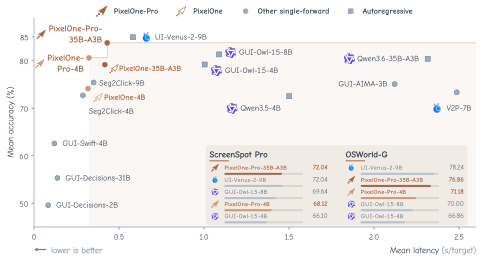
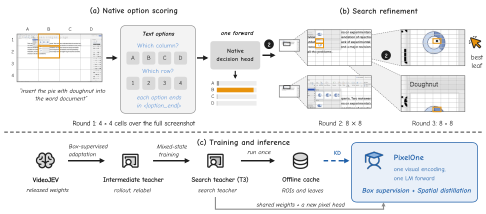

<h3 align="center"><strong><em>PixelOne:</em></strong> From Options to Pixels in a Single Forward for GUI Grounding</h3>

<p align="center">
  <a href="docs/PixelOne.pdf">Paper</a> ·
  <a href="https://tiankanghui.github.io/PixelOne/">Project page</a> ·
  <a href="https://huggingface.co/KangHui2200/PixelOne">Models</a> /
  <a href="https://huggingface.co/datasets/KangHui2200/PixelOne-Data">Data</a>
</p>

**Search during training. Direct clicks at inference.** PixelOne combines spatial distillation with a click-aligned pixel loss to predict precise clicks from native-resolution screenshots in a single forward pass.

<p align="center">
  <a href="docs/assets/teaser.svg"></a>
</p>

Four-benchmark mean accuracy and H200 latency at batch size 1. Inset accuracy axes start at 50%.

## Models

| Model | Mean accuracy ↑ | Mean latency ↓ | Parameters |
| :--- | ---: | ---: | :--- |
| **[PixelOne-Pro-4B](https://huggingface.co/KangHui2200/PixelOne/tree/main/PixelOne-Pro-4B)** | 80.62% | 0.323 s | 4B |
| **[PixelOne-Pro-35B-A3B](https://huggingface.co/KangHui2200/PixelOne/tree/main/PixelOne-Pro-35B-A3B)** | 83.77% | 0.431 s | 35B total, approximately 3B active |

Both checkpoints include all model weights and prediction heads. [Per-benchmark results and hardware requirements →](docs/INFERENCE.md#model-packages)

## Quick start

Use Python 3.12 with a CUDA-enabled PyTorch 2.11 installation:

```bash
python -m pip install -e .
python -m pip install flash-linear-attention==0.4.2 causal-conv1d==1.7.0 --no-build-isolation
```

Predict a click with either Pro model (authenticate with Hugging Face if required):

```bash
pixelone infer \
  --model KangHui2200/PixelOne \
  --subfolder PixelOne-Pro-4B \
  --image screenshot.png \
  --instruction "Click the search button" \
  --device cuda:0
```

The result contains `point: [x, y]` in **original screenshot pixels**. Use `PixelOne-Pro-35B-A3B` for the larger model. [Python API and inference details →](docs/INFERENCE.md#python-api)

## Training

See the **[training guide](docs/TRAINING.md)** for teacher training, distillation and model continuations, or **[dataset preparation](docs/DATASETS.md)** for annotations and source mixtures. The **[code guide](docs/CODE_GUIDE.md)** maps the implementation and suggests where to start reading.

## Demos

### Spreadsheet · 4K

PixelOne-Pro-4B checks a **12 × 13-pixel checkbox**, selects a cell, applies bold formatting, and opens the team forecast from native **3840 × 2160** screenshots. The workbook contains 48 distinct fictional projects.

[New 4K recording · 15.80 s · original speed](docs/assets/demos/spreadsheet-4k.mp4)

### Three Suns · 2K

PixelOne-Pro-35B-A3B completes **8/8 clicks** in our browser game from native **2560 × 1440** screenshots. The recording plays at original speed.

https://github.com/user-attachments/assets/60983252-5735-49be-a389-488aa5f106de

[Original 2K MP4](docs/assets/demos/three-suns-en-2k.mp4) · [Recording details](docs/DEMOS.md)

## Method

<p align="center">
  <a href="docs/assets/method-overview.svg"></a>
</p>

The teacher searches through row and column choices. The student inherits its parameters and learns from its spatial distributions. With Top20 supervision, the click-aligned winner loss encourages target pixels to outrank non-target pixels within the same token. At inference, the decision head selects a visual token and a lightweight pixel head selects the click within it, without running the search.
